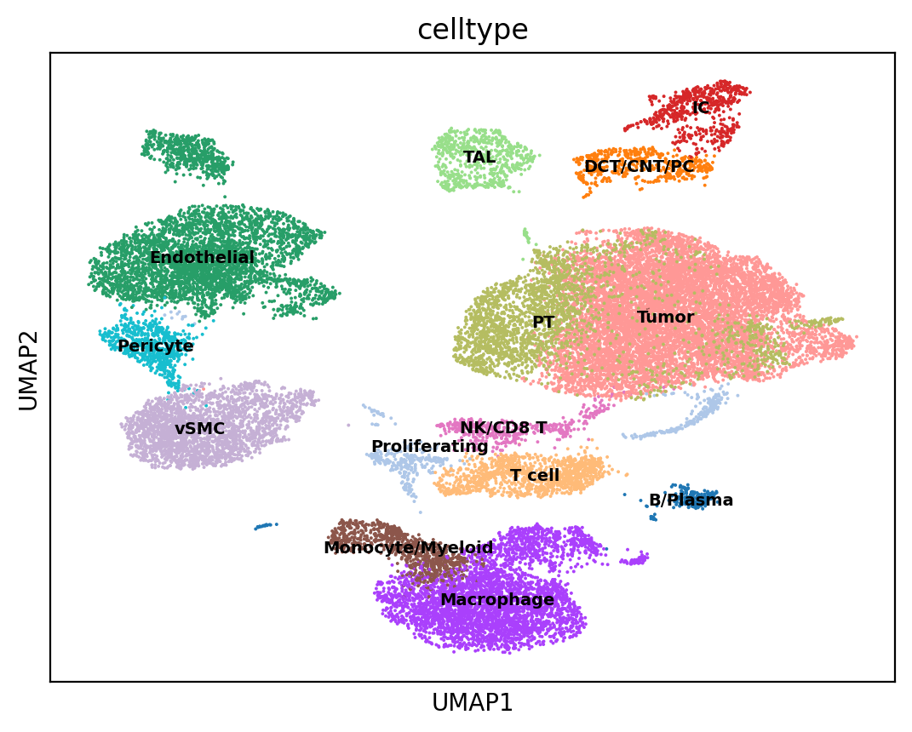
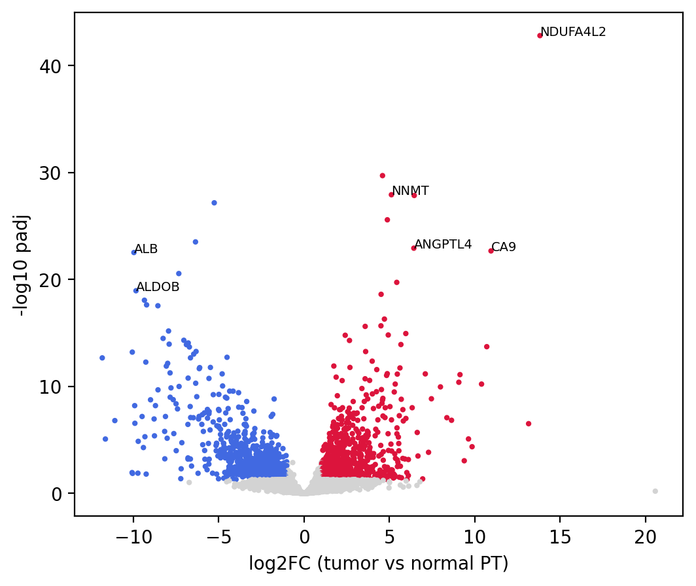
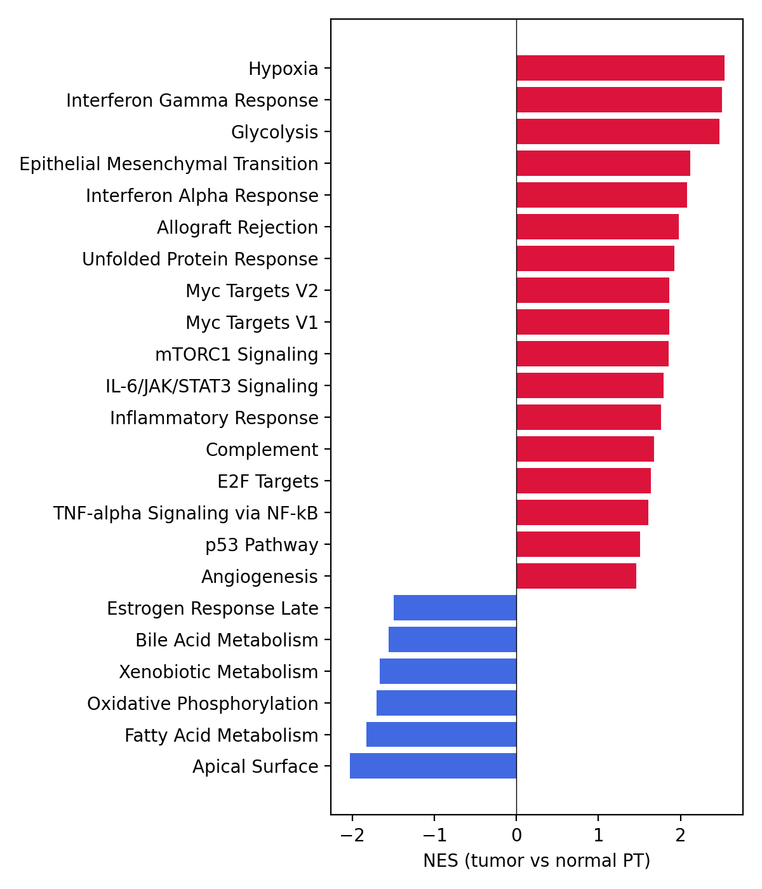

# scRNA-seq of clear cell renal cell carcinoma: tumor cells vs normal proximal tubule

I analysed public single-cell data from kidney cancer (GEO [GSE159115](https://www.ncbi.nlm.nih.gov/geo/query/acc.cgi?acc=GSE159115)) and compared tumor cells with normal proximal tubule cells, the cell type clear cell RCC comes from. The work runs from raw count matrices to cell types, differential expression and pathway analysis.

**Main result:** tumor cells switch on a hypoxia and glycolysis program (CA9, NDUFA4L2, ANGPTL4, HILPDA) and lose the normal functions of the tubule (ALDOB, ALB, fatty acid metabolism). A second analysis on matched patients gives the same picture.



## Data

- 7 ccRCC samples and 6 normal kidney samples from 8 patients (4 patients have both tumor and normal tissue)
- 29,499 cells before filtering, 27,166 after QC and doublet removal
- The chromophobe RCC samples from the same dataset are not used

## What I did

1. Loaded the 13 samples and merged them (Scanpy).
2. QC: at least 300 genes per cell, mitochondrial fraction up to 25% in tumor and up to 80% in normal tissue. My first threshold of 50% for normal cells removed 577 tubule cells that the authors had kept, because kidney tubule cells naturally have a lot of mitochondria. After raising it, all 26,894 cells from the authors' filtered annotation were kept.
3. Removed 292 doublets with Scrublet.
4. Normalization, 3,000 variable genes, PCA, Harmony to remove sample effects, UMAP, Leiden clustering (22 clusters).
5. Named the clusters by marker genes and checked them against the authors' labels. 17 of 22 clusters are at least 75% one authors' cell type.
6. Found 1,351 cells from normal samples that were labeled Tumor. Most of them are proximal tubule according to the authors, so I relabeled them PT.
7. Differential expression on pseudobulk (PyDESeq2): counts summed per patient inside one cell type, 7 tumor patients vs 5 normal patients. I did this because cells from one patient are not independent.
8. Same comparison on the 4 patients with both tissues, with patient as a covariate.
9. GSEA with the Hallmark gene sets.

## Results

**Differential expression.** 1,936 genes are significant (adjusted p < 0.05). With a 2-fold cutoff, 868 are higher and 934 lower in tumor. Top higher: NDUFA4L2, EGLN3, NNMT, HILPDA, ANGPTL4, CA9. Top lower: ALB, ALDOB, GPC3. The paired analysis finds 893 significant genes, 736 of them shared with the main one, and the fold changes correlate at 0.92.



**Pathways.** 23 of 50 Hallmark sets are significant.
- Higher in tumor: Hypoxia, Glycolysis, Interferon Gamma and Alpha response, EMT, Myc targets, mTORC1, Unfolded Protein Response
- Lower in tumor: Apical Surface, Fatty Acid Metabolism, Oxidative Phosphorylation, Xenobiotic and Bile Acid Metabolism

All 23 have the same direction in the paired analysis and 16 of them are also significant there. The four metabolic sets keep their direction but are not significant with only 4 pairs.



## Limits

- Small sample: 7 vs 5 patients, and only 4 pairs in the paired check.
- Tumor cells and normal proximal tubule look alike, so the relabeling in step 6 was a manual correction based on sample origin and the authors' labels.
- Some genes from other tubule parts (for example UMOD) show up at low levels in normal PT. This is probably ambient RNA, but I did not test it.
- Immune signals such as interferon response may partly come from neighboring immune cells.

## Files

```
scrna_seq_en.ipynb   full analysis, run top to bottom in Google Colab
results/             DE tables, GSEA tables, figures
```

The notebook installs its own packages and downloads the data from GEO (about 115 MB). Package versions are not pinned. It was run in Colab with Python 3.13 in October 2026.

Data: Zhang Y et al., single cell analysis of renal cell cancers, PubMed ID 34099557.
